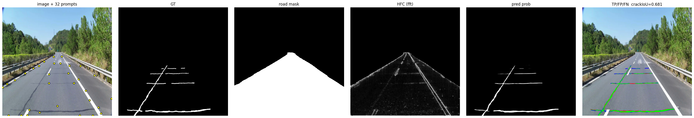
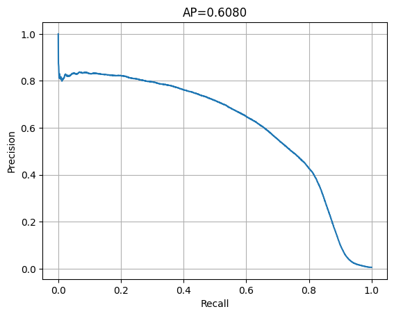

# Teaching SAM Domain-Specific Knowledge for Road Crack Segmentation (unofficial reimplementation)


An unofficial reimplementation of *Teaching Segment-Anything-Model Domain-Specific Knowledge for Road Crack Segmentation From On-Board Cameras* [1], written from the paper's description. The official code was not available, so some details are assumptions (listed below).

## Dataset
Download CrackSeg from the official repository: [TRMetaGroup/CrackSeg](https://github.com/TRMetaGroup/CrackSeg).

Expected layout:
```
CrackSeg/
  train/img, train/mask   # 2478 images
  val/img,   val/mask     # 354 images
  test/                   # 708 images, no public masks
```

## Setup
```
pip install torch transformers scikit-image opencv-python scikit-learn matplotlib tqdm
```
Run `train.ipynb` from top to bottom. Road masks are precomputed once into `CrackSeg/road_masks/`.

## Differences from the paper
| Item | Paper | This implementation |
|---|---|---|
| SAM | Official repo, ViT-B (but D=1024, L=24 match ViT-L) | Hugging Face `facebook/sam-vit-large` |
| Road mask | Semantic Segment Anything | SegFormer-B5 (Cityscapes), class "road" |
| Splits | 2478 / 354 / 708 | Train split by video into ~90% train / ~10% val; official val (354) used as test, since test masks are not public |
| HFC threshold for prompts, max points, augmentation ranges | Not specified | Assumed (`hf_thr=0.3`, `max_pts=32`, see `CFG`) |
| Epochs | 20 | <9 (stopped early: out of memory)> |

Results are therefore **not directly comparable** to the paper's.

## Results
On <the official val set (354 images)>, after <9> epochs, threshold 0.5:

| AP | crack IoU | mIoU (crack + background) |
|---|---|---|
| 0.608 | 0.4553 | 0.7255 |



### Do the prompts matter?
Removing the prompt points at inference does not reduce performance (crack IoU <36.79%> with prompts vs. <37.51%> without, on <split>). Only 4.50% of the generated prompts lie within 5 px of a ground-truth crack, and 5.03% within 5 px of a predicted crack. So in this reimplementation the model ignores the prompts, most likely because the prompt generator (with the assumed threshold and the SegFormer road mask) places most points off-crack. This is a test-time check, not a retrained ablation, and it does not show that prompts are unnecessary in the original method.

## To do
- Train the full 20 epochs.
- Tune the prompt threshold so that the points land on cracks, then retrain with and without prompts.
- Try the ridge-filter variant (`hfc_mode="ridge"` / `"both"`).

## References
[1] W. Zhou, H. Huang, H. Zhang and C. Wang, "Teaching Segment-Anything-Model Domain-Specific Knowledge for Road Crack Segmentation From On-Board Cameras," *IEEE Transactions on Intelligent Transportation Systems*, vol. 25, no. 12, pp. 20588–20601, Dec. 2024.